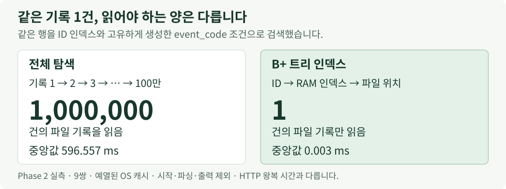
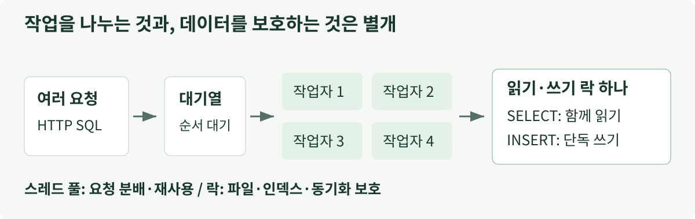
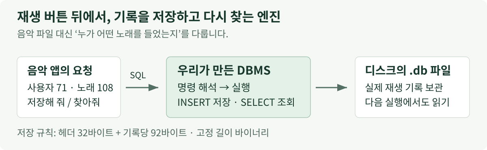

<!-- PROJECT_OVERVIEW -->
# Mini DBMS

SQL로 기록을 저장·조회하고, **B+ 트리 인덱스와 스레드 풀 API**로 확장한 C 기반 DBMS입니다. 음악 재생 기록을 예제 데이터로 사용합니다.

## 구현 내용

| 기능 | 직접 구현한 내용 | 선택 이유 |
| --- | --- | --- |
| SQL 처리 | 토큰화·구문 분석, INSERT/SELECT 실행 연결 | 문자열 명령을 실제 저장·조회 작업으로 변환 |
| 파일 저장 | 자동 ID, 기록당 92바이트 고정 길이 바이너리 | 기록 위치와 읽기·쓰기 규칙을 단순하게 관리 |
| ID 인덱스 | 메모리 B+ 트리의 삽입·검색·노드 분할, 재시작 시 재구성 | 전체 기록을 읽지 않고 ID에 해당하는 위치 검색 |
| 외부 요청 | HTTP API, 제한된 대기열, pthread 작업 스레드 풀 | 기존 엔진을 여러 클라이언트가 사용 |
| 동기화 | 하나의 읽기·쓰기 락, INSERT 성공 응답 전 파일 동기화 | 파일과 인덱스의 일관성 보호 |

## 핵심 설계와 고려한 점

### 검색 최적화 — 파일과 인덱스 분리

- **설계:** 실제 기록은 파일에, `ID → 파일 위치` B+ 트리 인덱스는 RAM에 저장
- **이유:** 전체 기록을 읽지 않고 필요한 기록의 위치 검색
- **한계:** 인덱스의 메모리·갱신 비용 발생, 재시작 시 재구성 필요
- **범위:** ID 검색만 인덱스 사용, 다른 열은 전체 탐색

### 동시 요청 — 스레드 풀과 읽기·쓰기 락

- **분배:** 미리 만든 작업 스레드가 대기열의 요청을 나눠 처리
- **대기열:** 크기를 제한하여 대기 요청의 무한 누적 방지
- **보호:** 하나의 읽기·쓰기 락 사용 — SELECT는 함께 읽고 INSERT는 단독 처리
- **한계:** 스레드가 여러 개여도 INSERT끼리는 순서대로 처리

### 저장 일관성 — 파일과 인덱스를 함께 보호

- **순서:** 쓰기 락 획득 → 파일 추가 → 인덱스 등록 → 파일 동기화 → 락 해제 → 성공 응답
- **이유:** 요청 처리 중 파일과 인덱스가 어긋난 상태로 조회되는 문제 방지
- **한계:** 디스크 반영을 기다리는 비용 발생
- **범위:** WAL 기반 트랜잭션·장애 복구는 미구현

음악 재생 기록은 엔진을 확인하기 위한 예제입니다. 핵심 결과물은 **SQL 처리 → 파일 저장 → 인덱스 검색 → 외부 동시 요청 처리**로 이어지는 DBMS이며, 아래에서는 검색량과 요청 처리의 정확성을 확인합니다.

## ID 검색 최적화

**실제 기록은 디스크에, `ID → 파일 위치` 인덱스는 RAM에 둡니다.** ID 조건은 B+ 트리를 사용하고, 다른 열은 전체 탐색합니다.



100만 건에서 같은 행을 찾은 Phase 2 내부 검색 9쌍의 중앙값입니다. OS 캐시 예열 상태이며 시작·파싱·출력을 제외했습니다. [측정 원본](docs/benchmarks/2026-11-16-phase2-million.json)

## 요청 처리와 동기화

**스레드 풀은 요청을 분배하고, 락은 공유 엔진을 보호합니다.** SELECT는 읽기 락을 공유하고, INSERT는 파일 저장·인덱스 등록·동기화까지 쓰기 락으로 보호합니다.



## 검증 결과

| 검증 대상 | 확인한 내용 |
| --- | --- |
| 저장·검색 | 저장 후 재조회, 재실행, 인덱스와 전체 탐색의 결과 일치 |
| 동시성 | SELECT 중첩, 쓰기 배제, ID 중복·누락과 인덱스 일치 |
| 오류·메모리 | 할당·파일 쓰기·동기화 실패 주입, ASan/UBSan 검사 |

코어·API의 **54개 테스트 묶음·케이스**를 일반 빌드와 ASan/UBSan 빌드에서 검증했습니다.

---

<details>
<summary><strong>실행 방법 · 지원 SQL · 구조 · 파일 형식 · 상세 검증과 한계</strong></summary>

### 전체 구조



C로 SQL 처리·파일 저장·B+ 트리 인덱스·스레드 풀 API를 단계적으로 구현하는 개인 과제다. Mini_Redis와 독립적으로 실행한다.

전체 구조·설계 이유·검증·한계를 빠르게 설명하려면 [구현 한 장 정리](docs/overview.md)를 참고한다.


## 현재 상태

- **Phase 1 구현 완료:** SQL 파일을 받는 CLI, INSERT/SELECT 파서, 실행기, 고정 길이 파일 저장을 연결했다.
- ID 자동 부여, 파일 재열기, 단일 등호 WHERE, 구문·자료형·문자열·파일 오류 처리와 메모리 검사를 검증했다.
- **Phase 2 구현 완료:** ID → 파일 위치 B+ 트리, 재실행 시 인덱스 복원, 100만 건 SQL 삽입과 같은 행의 검색 성능 비교를 검증했다.
- **Phase 3 구현 완료:** HTTP SQL API, 직접 만든 bounded queue/pthread 작업 풀, 읽기·쓰기 락, 요청당 INSERT 동기화와 종료 정리를 연결했다.
- `mini-dbms`가 SQL CLI이고, `storage-demo`는 파일 모듈을 직접 확인하는 보조 도구다.

## SQL 실행

아래는 `Mini_DBMS`를 연 Ubuntu 개발 컨테이너의 터미널에서 실행한다.

```bash
make cli
./build/mini-dbms examples/seed.sql
./build/mini-dbms examples/queries.sql
```

기본 저장 파일은 `data/play_history_v2.db`이며 CLI가 기본 data 디렉터리를 생성한다.
첫 명령은 기록 3개를 추가하고 사용자71의 기록을 조회한다. 두 번째 실행은 이전 프로세스가 저장한 파일을 다시 열어 조회한다.
`seed.sql`을 다시 실행하면 기존 데이터 뒤에 추가하며, 데이터나 ID를 초기화하지 않는다.

별도 파일을 지정하려면 부모 디렉터리를 먼저 준비한다.

```bash
mkdir -p data
./build/mini-dbms --db data/experiment_v2.db examples/seed.sql
```

결과는 JSON Lines다. 각 SELECT는 `type=row`인 결과 행과 `type=select`인 matched/scanned 집계와 access_path/index_nodes를 출력한다. scanned는 SQL 실행 중 읽은 파일 기록 수이며 시작할 때의 파일 검증·인덱스 복원은 포함하지 않는다. index_nodes는 방문한 B+ 트리 노드 수다.
마지막 `type=summary, status=ok`는 파일 동기화·닫기가 성공한 뒤 출력된다. selected는 모든 SELECT에서 반환한 행 수의 합계다.

```text
{"type":"row","statement":4,"record":{"id":1,"event_code":"PLAY000001","user_id":71,"song_id":305,"genre":"rock"}}
{"type":"row","statement":4,"record":{"id":3,"event_code":"PLAY000003","user_id":71,"song_id":108,"genre":"pop"}}
{"type":"select","statement":4,"matched":2,"scanned":3,"access_path":"full_scan","index_nodes":0}
{"type":"summary","status":"ok","statements":4,"inserted":3,"selected":2}
```

## 지원 SQL 범위

```sql
INSERT INTO play_history (event_code, user_id, song_id, genre)
VALUES ('PLAY000001', 71, 305, 'rock');
SELECT * FROM play_history;
SELECT * FROM play_history WHERE id = 1;
SELECT * FROM play_history WHERE event_code = 'PLAY000001';
SELECT * FROM play_history WHERE user_id = 71;
SELECT * FROM play_history WHERE genre = 'rock';
```

- 스키마·테이블은 고정으로 존재하며 CREATE TABLE은 필요 없다.
- INSERT는 위의 네 입력 열을 각각 한 번 명시한다. 순서는 바꿀 수 있다. id는 입력할 수 없다.
- SELECT는 `*`와 선택적인 단일 `WHERE 열 = 값`을 지원한다. 다섯 열 모두 조건으로 사용 가능하다.
- 키워드·테이블·열 이름의 ASCII 대소문자는 무시하고 문자열 값은 보존한다.
- 여러 줄 문장, `--` 줄 주석, 여러 문장을 지원한다. 문장은 세미콜론으로 구분하며 마지막 세미콜론은 생략할 수 있다.
- 문자열은 작은따옴표로 감싸며 값 안의 작은따옴표는 `''`로 쓴다. 백슬래시는 일반 문자다.
- 숫자는 부호 없는 64비트 정수이며 INSERT의 user_id/song_id는 양수여야 한다. 문자열은 현재 고정 스키마의 ASCII 값이다.
- 열 선택·AND/OR·JOIN·범위 조건·UPDATE/DELETE·블록 주석 등은 지원하지 않고 오류로 거절한다.
- 첫 오류에서 중지하고 행/열 위치 또는 실행 오류를 stderr에 출력한다. SQL 파일 전체를 트랜잭션으로 처리하지 않으므로 **이전 성공 INSERT는 남을 수 있다.**
- SQL 파일은 최대256MiB를 메모리에 읽는다. 결과는 콜백으로 한 행씩 출력하며 전체 결과 목록을 메모리에 모으지 않는다.
- `WHERE id = 값`은 B+ 트리로 검색해 파일 기록을 최대 한 개 읽는다(access_path=bplus_tree). 없는 ID는 matched=0, scanned=0이다. 다른 열과 전체 SELECT는 full_scan이다. 파일 로딩·시작 검증·인덱스 복원·화면 출력 비용은 검색 시간과 구분한다.

## 실행 환경

Windows VS Code에서 이 `Mini_DBMS` 폴더를 열고 `Dev Containers: Reopen in Container`를 실행한다. `.devcontainer` 설정이 Ubuntu 22.04, GCC, make, Python3를 준비한다. 컨테이너의 터미널에서:

```bash
make test
make sanitize
make http-test
make http-sanitize
```

자동 테스트는 `/tmp`의 임시 파일을 사용하며 실제 `data/`를 변경하지 않는다.
B+ 트리3개 묶음, 저장 모듈8개 묶음, 저장 프로세스1개, 파서6개 묶음, 실행기4개 묶음, CLI12개, 성능 도구2개, 동시성3개 묶음, 내구성1개 묶음, 스레드 풀3개 묶음으로 핵심43개를 일반 빌드 및 ASan/UBSan 빌드로 실행한다. 파서에는 임의 바이트 입력1만 개와 문자열 소유권 검사도 포함한다. 부분 쓰기와 fsync 실패는 테스트에서 인위적으로 주입한다.

Windows PowerShell에서 컨테이너 이미지로 바로 검증하는 방법:

```powershell
docker build -t mini-dbms-dev -f .devcontainer/Dockerfile .
docker run --rm --ulimit core=0 --mount "type=bind,source=$($PWD.Path),target=/workspaces/Mini_DBMS" -w /workspaces/Mini_DBMS mini-dbms-dev make test sanitize http-test http-sanitize
```

위 명령은 `Mini_DBMS` 폴더에서 실행한다. 빌드 결과와 데이터는 Git에서 제외한다.

## 저장과 재읽기 직접 보기

개발 컨테이너 안에서:

```bash
make storage-demo
mkdir -p data
./build/storage-demo write data/play_history_v2.db
./build/storage-demo read data/play_history_v2.db
```

처음 쓰면 `SAVED id=1 offset=32`가 출력된다. `write`를 다시 실행하면 id=2, offset=124로 추가된다. 두 실행은 별도 프로세스이며, `read`는 파일에 남은 기록을 읽는다. 샘플 event_code는 반복 저장될 수 있다. 파일을 지우면 그 파일의 모든 기록과 ID 이력이 사라지므로 테스트 데이터만 사용한다.

## 데이터와 파일 구조

| 필드 | 의미 | 예시 |
| --- | --- | --- |
| id | DBMS 자동 부여 번호 | 1 |
| event_code | 외부 재생 사건 코드, ASCII 1~31바이트 | PLAY000001 |
| user_id | 양의 정수 사용자 번호 | 71 |
| song_id | 양의 정수 곡 번호 | 305 |
| genre | 장르 이름, ASCII 출력 문자 1~31바이트 | rock |

장르는 고정 목록 없이 저장한다. 예: `pop`, `k-pop`, `rock`, `alternative rock`, `indie rock`, `metal`, `punk`, `hip-hop/rap`, `r&b/soul`, `jazz`, `blues`, `electronic/dance`, `house`, `techno`, `classical`, `folk`, `country`, `reggae`, `latin`, `soundtrack`. 이는 예시이며 산업 공통 표준이나 허용 목록이 아니다. 문자열 값은 대소문자를 구분하므로 `rock`, `Rock`, `lock`은 서로 다른 값이다. 현재는 ASCII만 지원하며 한국어 장르는 지원하지 않는다. 한 레코드는 하나의 장르 문자열을 가지며 장르별 집계·추천·다중 장르 모델은 구현하지 않는다.

2026-11-16에 재생 시각을 장르로 교체했다. 현재 파일 형식은 v2(헤더 version=2, 레코드 92바이트)다. 이전 v1 파일 `data/play_history.db`는 그대로 보존하며 자동 변환하지 않는다. 새 CLI는 기본적으로 `data/play_history_v2.db`를 사용하고, v1 파일을 명시하면 변경 없이 열기를 거절한다. 새 예제의 초기 데이터가 필요하면 위 seed 명령을 새 파일에 한 번 실행한다.

한 행은 음악 한 곡이 아니라 **재생 사건 한 번**이다. 같은 사용자·곡의 반복 재생도 별개 행이다. event_code의 유일성은 현재 강제하지 않는다.

```text
play_history.db
├─ 파일 헤더: 32바이트 (형식·버전·레코드 크기·체크섬)
├─ 레코드 1: 92바이트 (시작 위치 32)
├─ 레코드 2: 92바이트 (시작 위치 124)
└─ ...
```

C 구조체의 메모리를 그대로 파일에 쓰지 않는다. 정수는 little endian, 문자열은 NUL 종료 및 0 패딩, 헤더·각 행은 FNV-1a32 체크섬으로 명시적으로 인코딩한다. 이 체크섬은 우발적인 손상 검출용이며 변조 방지나 모든 손상 검출을 보장하지 않는다. 상세 바이트 규칙은 [저장 설계](docs/superpowers/specs/2026-11-15-storage-design.md)에 있다.

## 핵심 경계와 한계

- 파일을 다시 열 때 모든 행과 ID 순서를 검증하고 다음 ID를 정한다. 파일 크기만 믿지 않는다.
- 잘못된 입력은 쓰기 전에 거절한다. 손상 파일과 불완전한 마지막 행은 자동 삭제·잘라내기 없이 열기를 거절한다.
- 파일 하나는 프로세스 간 배타적으로 연다. 같은 파일을 CLI와 서버에서 동시에 열 수 없다. 한 서버 안에서는 엔진 읽기·쓰기 락이 파일과 인덱스를 함께 보호한다. SELECT끼리는 병렬, INSERT와 sync는 배타적이다. 콜백은 락 안에서 호출되므로 같은 엔진을 재호출하면 안 되고, close는 모든 작업이 끝난 후 수행한다. 직접 storage API를 병렬로 호출하는 것은 지원하지 않는다.
- `db_append`는 운영체제 쓰기 완료, `db_sync`/`db_close` 성공은 fsync 완료를 뜻한다. 행마다 fsync하지 않는다. 데모의 SAVED 출력은 close 성공 이후다.
- 쓰기·동기화 오류가 나면 추가 쓰기를 막는다. 오류가 나기 전 정상 행은 조회할 수 있다. 실패한 쓰기가 실제 파일에 남았는지는 불확실할 수 있다.
- Redis의 AOF와 같은 복구 로그, 트랜잭션, 원자적 일괄 삽입, 전원 장애 복구는 이번 단위에서 제공하지 않는다. 정상 저장·닫기 뒤 다른 프로세스로 다시 읽는 것을 검증한 단계다.
- 고정 길이·연속 ID라 직접 위치 계산도 가능하지만, 과제의 ID 검색은 실제 B+ 트리를 사용한다. ID로 오프셋을 계산하는 우회 경로는 쓰지 않는다.
- 인덱스는 RAM에만 있고 파일 형식 v2는 유지한다. 열 때 파일을 읽어 재구성하므로 시작 시간은 O(N)이다. 저장 전 분할 노드 메모리를 확보해 파일 저장 후 메모리 할당 실패로 인덱스가 누락되는 일을 막는다.


## Phase 2 — 인덱스 직접 확인

기존 practice_genre.db에 기록 3개를 저장했다면 추가 INSERT 없이 아래 조회만 실행할 수 있다.

```bash
make cli
./build/mini-dbms --db data/practice_genre.db examples/index_queries.sql
```

ID 2는 인덱스를 통해 한 행만 읽는다. song_id=108은 모든 행을 읽어 조건을 비교한다. ID 999999999는 없는 ID이므로 파일 기록을 읽지 않고 정상적으로 0개를 반환한다. seed를 반복 실행했다면 일반 조건의 결과 개수는 늘어난다.

## Phase 2 — 100만 건 성능 비교

아래는 Ubuntu 개발 컨테이너 터미널에서 실행한다. `mktemp`가 매번 별도 디렉터리를 만들므로 연습용 데이터와 섞이지 않는다. 생성기와 측정 도구는 기존 경로 덮어쓰기를 거절한다.

```bash
make benchmark
bench_dir=$(mktemp -d)
python3 tools/generate_history.py --count 1000000 --output "$bench_dir/load.sql"
./build/benchmark "$bench_dir/load.sql" "$bench_dir/history.db" 9
```

생성기는 약104MB의 SQL INSERT 파일을 만든다. 측정 도구는 같은 Phase 1 파서와 엔진으로 100만 건을 삽입하고 동기화·닫기 후 다시 열어 인덱스를 복원한다. 각 쌍은 `WHERE id=...`와 유일한 `WHERE event_code='PLAY...'`로 **동일한 기록 한 건**을 찾아 전체 필드를 비교한다. 장르 조회는 결과가 많을 수 있어 공정한 시간 비교 대상으로 사용하지 않는다.

검색 측정은 SQL 파싱 이후 엔진 호출+행 확인 콜백을 포함하고, 시작 검증·인덱스 재구성·결과 출력은 제외한다. 양쪽 경로를 2회 예열하고 실행 순서를 번갈아 9회 측정해 중앙값과 최소/최대를 보고한다. 운영체제 파일 캐시가 따뜻한 단일 프로세스 실험이며 디스크 캐시가 비어 있는 환경이나 동시성 부하 실험은 아니다. benchmark는 -O2, sanitizer는 별도 비최적화 메모리 검사다. 기본 CLI의 디버그 빌드와 시간을 직접 비교하면 안 된다.

2026-11-16 Phase 2 완료 시점(Phase 3 락 추가 전)의 Docker Linux /tmp 측정: 1,000,000건, 파일92,000,032바이트. 삽입·동기화 약1.613초, 파일 검증+인덱스 복원 약0.787초. 검색 중앙값은 ID 인덱스0.003001ms, event_code 전체 탐색596.556530ms. 각 ID 검색은 트리 노드5개와 파일 기록1개, 선형 검색은 기록1,000,000개를 읽었다. 기기·파일시스템·캐시·데이터 분포에 따라 달라지는 예시이며 상용 DBMS 성능 수치가 아니다.

[실측 원본과 환경](docs/benchmarks/2026-11-16-phase2-million.json)

## Phase 3 — HTTP API 실행

VS Code의 Mini_DBMS Ubuntu 컨테이너 터미널 하나에서:

```bash
make server
./build/mini-dbms-server --db data/practice_genre.db
```

기존 연습 파일을 사용하며 해당 파일을 열어둔 다른 CLI/서버는 없어야 한다. LISTENING 127.0.0.1:8091이 보이면 계속 켜 둔다. 다른 컨테이너 터미널에서:

```bash
curl -s http://127.0.0.1:8091/health
curl -s http://127.0.0.1:8091/sql -H 'Content-Type: text/plain' --data-binary 'SELECT * FROM play_history WHERE id = 2;'
```

SQL은 JSON에 감싸지 않고 text/plain 또는 application/sql 본문으로 보낸다. 한 요청은 SQL 문장 하나만 허용한다. 여러 문장/잘못된 뒤쪽 SQL은 첫 문장 실행 전 거절한다. CLI의 여러 SQL 파일 실행 방식은 유지한다.

응답 예: `{"status":"ok","worker_id":1,"operation":"select","rows":[{"id":2,"event_code":"PLAY000002","user_id":32,"song_id":108,"genre":"pop"}],"matched":1,"scanned":1,"access_path":"bplus_tree","index_nodes":1}`. worker_id는 요청을 처리한 재사용 작업 스레드의 번호이고 실행마다 달라질 수 있다. INSERT는 inserted=1과 새 record를 반환하고 fsync 성공 전에는 성공 응답을 보내지 않는다. SELECT 결과 없음은200과 빈 rows다.

서버 터미널의 Ctrl+C로 종료한다. 수신을 중단하고 대기 소켓은 닫으며 처리 중인 작업을 마친 뒤 스레드를 join하고 엔진을 닫는다. SQL 자체를 강제 취소하지 않으므로 큰 선형 조회/느린 디스크 sync가 진행 중이면 완료까지 기다린다. 네트워크 읽기와 응답 전송에는 각각5초 상한이 있다.

기본은 작업 스레드4개, 대기열64개다. `--workers 1..32`, `--queue 1..1024`, `--port 0..65535`로 조정할 수 있다. 포트0은 자동 선택으로 테스트에 사용한다. 기본 주소는127.0.0.1이며 외부 연결은 명시적으로 `--host 0.0.0.0`을 지정해야 한다. 인증/TLS가 없는 학습 서버이므로 접근 가능한 사람에게 SQL 실행 권한이 생긴다. 기본 로컬 접근으로 사용한다.

VS Code Ports에서8091을 포워딩하면 Windows에서도 접속할 수 있다. 새 DevContainer 설정에는 forwardPorts=[8091]이 있다. Windows PowerShell에서는 curl 별칭 대신 아래를 사용할 수 있다.

```powershell
Invoke-RestMethod http://127.0.0.1:8091/health
Invoke-RestMethod http://127.0.0.1:8091/sql -Method Post -ContentType 'text/plain' -Body 'SELECT * FROM play_history WHERE id = 2;'
```

## Phase 3 — 구조·오류·품질

수신 메인 스레드 → 크기가 제한된 fd 대기열 → 재사용 pthread 작업 스레드 → SQL 파서 → 공유 엔진 순서다. 작업 스레드가 HTTP 본문을 읽고 SQL을 실행하며 응답을 만든다. 결과를 메모리에 완성하고 엔진 락을 해제한 뒤 네트워크에 전송한다. 느린 응답 수신자가 엔진 락을 점유하지 않는다. 각 요청에서 엔진을 새로 열거나 인덱스를 재구성하지 않는다.

SELECT는 읽기 락을 공유하고 INSERT는 쓰기 락으로 메모리 준비·파일 저장·인덱스 등록·fsync를 보호한다. Linux pthread의 writer-preference nonrecursive RW lock을 사용해 연속 조회가 대기 중인 쓰기를 계속 추월하지 않게 한다. 파일의 읽기 오류 플래그는 여러 reader가 동시에 표시할 수 있어 atomic이다. CLI/성능 도구는 배치 종료 시 sync, API는 각 INSERT 성공 전 sync 정책이므로 쓰기 속도를 동일하게 해석하면 안 된다.

HTTP는 요청당 연결 하나(Connection: close), Content-Length가 있는 POST만 지원한다. Transfer-Encoding/Expect는 거절하며 현재 도착한 추가 파이프라인 바이트도 거절한다. 실행 이후 도착한 바이트는 다음 요청으로 처리하지 않고 연결 종료로 버린다. 헤더8KiB/SQL16KiB/조회1000행/응답256KiB 제한이 있다. 조회가 제한을 넘으면 일부 성공이 아닌413 오류이며 WHERE로 범위를 줄여야 한다. 현재 LIMIT/페이지네이션 SQL은 없다.

오류 상태: 잘못된 HTTP/SQL·복수 문장400, 없는 경로404, 잘못된 메서드405, 읽기 시간 초과408, 길이 없음411, 크기·결과 제한413, 본문 형식415, Expect417, 잘못된 레코드 값422, 메모리/파일/동기화 오류500, 대기열 포화503. 대기열이 가득 차 거절된 연결은 SQL을 실행하지 않는다. 실행 후 응답을 잃으면 저장이 없었다고 단정할 수 없고, 자동 재시도 중복을 막는 idempotency 키는 제공하지 않는다.

HTTP 구문 분석은 [picohttpparser](https://github.com/h2o/picohttpparser)의 고정 revision을 third_party에 포함해 사용한다. 출처·MIT 라이선스는 같은 디렉터리에 있다. API/프레이밍 제한/스레드 풀/DB 엔진은 직접 구현했다.

`make test sanitize`의 핵심43개와 `make http-test http-sanitize`의 HTTP11개, 총54개 테스트 묶음·케이스가 각 일반/ASan·UBSan 빌드에서 통과했다. SELECT 병렬 콜백, 쓰기 배제, 120클라이언트 작업의 ID 누락/중복·조회 일치, fsync 실패의 불확실한 결과, 풀 할당/부분 스레드 생성 실패 정리, 대기열 포화·회복, 분할·중단 요청, 복수 SQL 실행 전 차단, 결과 제한, 느린 요청 중 종료 및 응답 뒤 SIGKILL 후 재실행을 포함한다. ThreadSanitizer·장시간 운영 부하·전원 장애 복구는 검증하지 않았다. Windows 호스트에서 임시 Docker 포트로 실제 API 저장/ID 조회도 확인했으며 사용자 data 파일은 변경하지 않았다.

## 과제 요구사항 대응

24명의 동시 API 요청을 눈으로 확인하려면 컨테이너 터미널에서 실행한다.

```bash
make server
python3 tools/demo_concurrency.py
```

실습 도구가 별도 임시 서버·DB를 만들고 24개의 저장 요청을 동시에 보낸다. 각 작업 스레드의 담당 요청과 실제 DB/인덱스의 결과 일치를 출력한 뒤 정리한다. 기존 서버를 끄거나 data 파일을 변경할 필요는 없다. 요청을 처리하는 스레드는 여러 개지만 INSERT의 파일·인덱스 변경은 쓰기 락으로 순서대로 보호한다. 담당 건수나 ID 부여 순서는 실행마다 달라질 수 있다. 이 실습은 요청 분배·재사용과 결과 정확성 확인이며 SQL 연산의 실제 시간 중첩을 계측하는 성능 실험은 아니다.

| 요구사항/중점/품질 | 구현 및 검증 |
| --- | --- |
| Phase 1: SQL 텍스트파일 CLI 입력, 파싱·INSERT·SELECT | main.c/sql.c/engine.c/storage.c, 파서·실행기·CLI 테스트 |
| 파일 기반 테이블·자동 ID | v2 고정 길이 파일, ID와 체크섬 검증, 별도 프로세스 재열기 테스트 |
| Phase 2: 같은 처리기와 메모리 B+ 트리 | engine.c의 ID 경로, bptree.c, 분할·역순·무작위·할당 실패 테스트 |
| 100만 건·인덱스/비인덱스 비교 | SQL 생성기와 benchmark, 같은 한 행 비교, 실측 JSON |
| Phase 3: 외부 API와 내부 엔진 연결 | POST /sql, GET /health, Windows 호스트 접속 검사 |
| 스레드 풀 병렬 처리 | 직접 만든 bounded fd queue·pthread pool, worker 재사용·reader 동시 실행 검증 |
| 멀티스레드 동시성 | writer-preference RW lock, 파일+인덱스+fsync 보호, 동시 ID/조회·재열기 검증 |
| 단위·기능·엣지 케이스 | 핵심43+HTTP11, 일반 및 ASan/UBSan, 메모리·파일·동기화·부분 스레드 생성 오류 주입 |

추가 구현 요소는 파일 손상 검사/원본 보존, 할당 실패 전에 인덱스 메모리 준비, API 오류·크기 제한, 대기열 포화 처리, 종료 정리다. 인증·사용자 UI·트랜잭션·WAL 복구·실시간 음악 재생/추천은 이번 결과물의 범위 밖이다.

</details>
