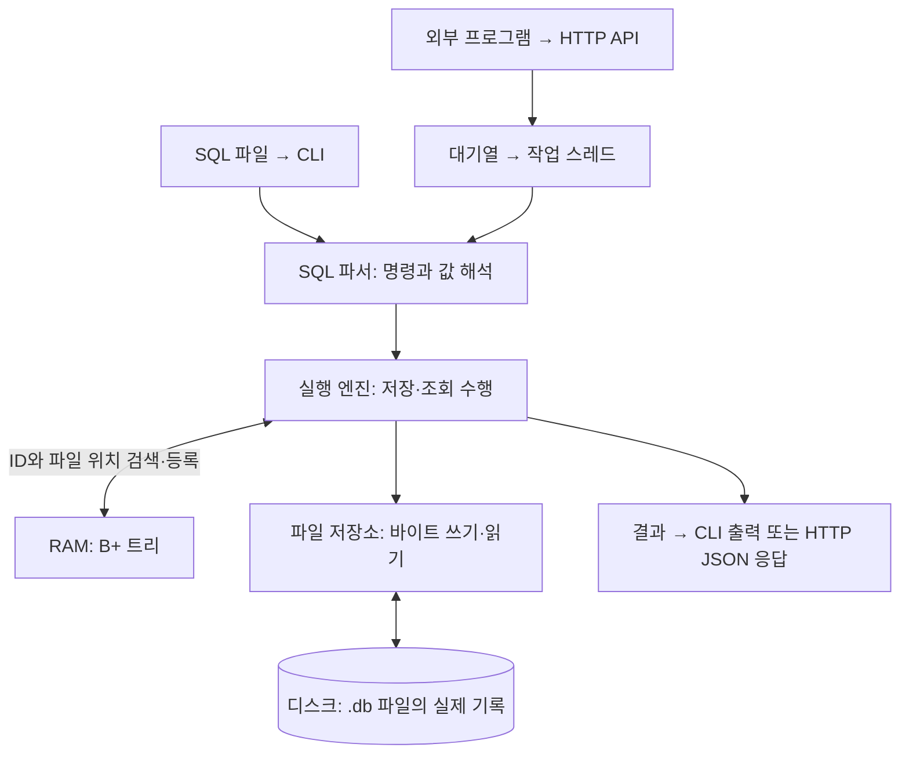

# 미니 DBMS — 구현과 설명 한 장 정리

음악 재생 기록을 예제 데이터로 사용하는 **C 기반 SQL 저장·조회 엔진**이다. 음악 재생 앱이나 추천 서비스를 만든 것은 아니다. 한 행은 노래 한 곡이 아니라 **사용자가 노래를 재생한 사건 한 번**이다.

## 무엇을 만들었나

| 단계 | 직접 구현한 것 | 가능해진 일 |
| --- | --- | --- |
| Phase 1 | SQL 파서·실행 엔진·파일 저장소·CLI | SQL 파일의 INSERT/SELECT를 해석해 저장·조회 |
| Phase 2 | 메모리 B+ 트리, 저장 시 인덱스 등록, 시작 시 인덱스 재구성 | ID로 파일 위치를 찾아 해당 기록만 읽기 |
| Phase 3 | HTTP API, 제한된 대기열, pthread 스레드 풀, 읽기·쓰기 락 | 외부 요청을 계속 받아 여러 작업 스레드로 안전하게 처리 |

## 전체 구조

CLI와 API는 **같은 파서와 엔진**을 사용한다. CLI는 SQL 파일 처리 후 종료하고, API 서버는 엔진을 유지하며 다음 요청을 기다린다. 프로그램 시작 시 파일을 검증하고 RAM의 인덱스를 구성한다. 재실행·재읽기는 별도 반복 작업이 아니라 **다음 실행에서도 이전 파일을 사용할 수 있다는 기능**이다.

## 저장·검색·동시성을 어떻게 설계했나

| 선택 | 이유와 동작 | 비용·주의점 |
| --- | --- | --- |
| 고정 길이 바이너리 파일 | 헤더32바이트 + 기록당92바이트. 위치 계산과 읽기·쓰기 규칙이 단순함 | 짧은 문자열도 고정 공간 사용. 바이너리와 고정 길이는 별개 특성 |
| ID B+ 트리 | 리프에 ID→파일 위치 저장, 내부 노드는 범위를 안내. 분할하며 확장 | ID에만 인덱스가 있음. 다른 열은 전체 탐색, 시작 시 재구성 비용 발생 |
| 스레드 풀 | 기본 작업 스레드4개가 대기열에서 연결을 받아 재사용 | 기본 대기64개, 포화 시503. 작업 분배만으로 데이터가 보호되지는 않음 |
| 읽기·쓰기 락 하나 | SELECT는 읽기 모드를 공유. INSERT는 쓰기 모드로 메모리 준비→파일 저장→인덱스 등록→fsync까지 단독 처리 | 쓰는 동안 다른 읽기·쓰기는 대기. 느린 네트워크 전송은 락 해제 후 수행 |

기록의 항목은 `id`, `event_code`, `user_id`, `song_id`, `genre`다. `id`는 저장소가 자동 부여하는 기록 번호, `user_id`는 요청에서 전달하는 사용자 번호다. 파일에는 **실제 기록**을 바이트로 저장하고, 파싱한 명령 구조체는 RAM에서 실행에 사용한다. SQL은 요청 언어, JSON은 API 응답 형식이다.

## 무엇을 검증했나

2026-11-16 검증 기록: **핵심43개 + HTTP11개 = 총54개 테스트 묶음·케이스**를 일반 빌드와 ASan/UBSan 빌드에서 각각 통과했다. 이는 54개의 개별 입력만 검사했다는 뜻이 아니다.

- **단위·기능:** SQL 문법·자료형, 저장·조회·다른 프로세스에서 재열기, B+ 트리의 순서별 삽입·다단계 분할·없는 키 검색.
- **오류·메모리:** 잘못된 입력과 손상 파일 거절·원본 보존, 메모리 할당·부분 쓰기·fsync·부분 스레드 생성 실패 처리, 메모리 오류·누수 검사.
- **동시성·API:** SELECT 콜백의 실제 중첩과 쓰기 배제, 동시 저장의 ID·인덱스 일치, 대기열 포화·회복, 분할·중단 요청, 결과 제한, 종료·재시작. Windows 호스트 접속도 확인했다.
- **직접 실습:** 24개 동시 저장 요청을 스레드4개로 처리하고, 기록24개·ID 중복/누락0개·ID 재조회24개 일치를 확인했다. 이 출력 자체는 SQL 실행의 시간 중첩을 측정한 결과는 아니다.

**100만 건 성능 비교:** 같은 기록 하나를 `id` 인덱스와 고유하게 생성한 `event_code` 전체 탐색으로 찾아 결과 전체를 비교했다. 9쌍 측정 중앙값은 약 **0.003ms 대 596.557ms**, 읽은 파일 기록은 **1개 대 100만 개**였다. Phase 2 완료 시점, 따뜻한 OS 캐시·단일 프로세스 조건의 값이며 시작·파싱·출력 비용은 제외했다. 현재 HTTP API의 응답 시간이나 일반적인 상용 DBMS 성능으로 해석하면 안 된다. [환경과 실측 원본](benchmarks/2026-11-16-phase2-million.json)

## 설명할 수 있어야 할 한계

- 고정 테이블과 INSERT/SELECT·단일 등호 WHERE만 지원한다. JOIN·집계·정렬·UPDATE/DELETE·트랜잭션은 없다. CLI는 첫 오류에서 멈추지만 이전 성공 INSERT는 남을 수 있다.
- API는 요청당 SQL 하나, 조회 최대1000행이다. 인증·TLS·페이지네이션은 없고 기본 로컬 접속이다. HTTP 구문 분석은 외부 라이브러리 picohttpparser를 사용했다.
- API의 INSERT는 fsync 후 성공을 응답하지만 WAL·전원 장애 자동 복구는 없다. 응답을 잃거나 동기화가 실패하면 저장되지 않았다고 단정하거나 롤백을 주장할 수 없다.
- 인덱스는 RAM에만 있고 시작 시 전체 기록을 읽어 재구성한다. 장시간 운영 부하·ThreadSanitizer·전원 장애 복구를 검증한 것은 아니다.

## 팀원에게 짧게 설명하기

> C로 SQL 파일과 HTTP 요청을 처리하는 미니 DBMS를 구현했습니다. 음악 재생 기록을 고정 길이 바이너리 파일에 저장하고, ID와 파일 위치를 연결한 메모리 B+ 트리로 ID 조회를 개선했습니다. API 서버에서는 직접 만든 스레드 풀이 요청을 처리하며, 읽기·쓰기 락 하나로 여러 조회는 함께 실행하고 저장은 파일·인덱스 갱신과 동기화까지 단독으로 보호합니다. 100만 건 검색 비교와 단위·기능·동시성·오류 테스트를 수행했습니다. SQL 지원 범위는 제한적이며 트랜잭션과 WAL 복구는 제공하지 않습니다.

실행·실습 명령은 [README](../README.md), 주요 코드는 [파서](../src/sql.c)·[실행 엔진](../src/engine.c)·[저장소](../src/storage.c)·[B+ 트리](../src/bptree.c)·[스레드 풀](../src/pool.c)·[서버](../src/server.c)에서 확인할 수 있다.
